# Three-seed JackGPT results

[Read the final report](report.md). Finalized 2026-10-14 UTC; published to this repository on 2026-10-16.

The report covers nine independently trained models (three seeds per condition), seventeen full EV cohorts and six matched-history evaluations on the same 75 pairs. All 35 retained paper-comparison entries and eleven figures are complete. Model-dependent headline values include each seed and mean ± sample standard deviation (ddof=1). Training dynamics is intentionally omitted. Protocol corrections and limitations are documented in the report.

This directory contains the original report, numerical tables, figures and compact verification evidence. See the [sanitization record](SANITIZATION.md) for publication-only metadata changes. The report and evidence retain archive-relative paths and reproduction commands from the isolated experiment workspace. Those commands require that full workspace; the raw datasets, checkpoints, logits, gameplay traces and experiment runners are not included in this publication. Statements about leaving the original checkout and GitHub unchanged describe the experiment phase, before this publication.

## Tables

- [Headline results: CSV](tables/headline_results.csv) · [JSON](tables/headline_results.json)
- [All aggregate metrics: CSV](tables/aggregate_metrics.csv) · [JSON](tables/aggregate_results.json)
- [EV by training seed, with shoe-cluster uncertainty](tables/ev_per_seed.csv)
- [Paired EV differences and uncertainty](tables/paired_ev_per_seed.csv)
- [Comparison with all 36 original paper entries](evidence/paper_comparison_36_rows.json) (includes the omitted training-dynamics entry)

## Figures

Each figure is available as PNG, SVG and PDF, with its verified plot data. Training-seed SD is kept separate from gameplay sampling uncertainty.

### Main probes finite iid

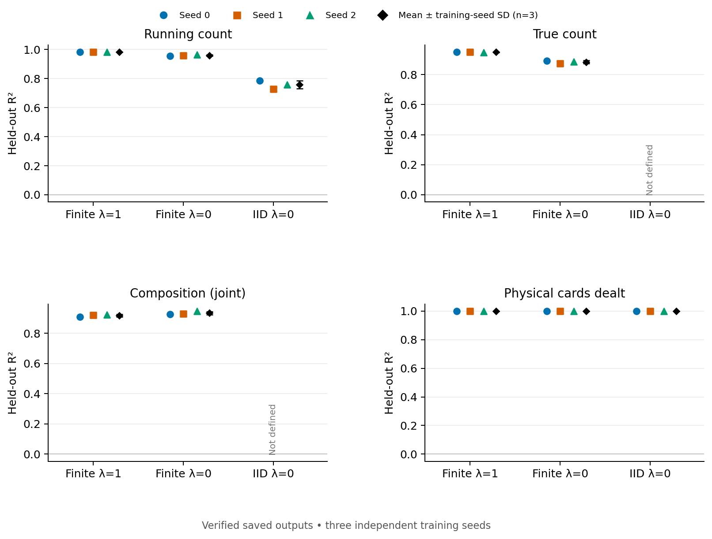

Card-position probes. Layer/alpha selected on 1200 fit shoes; evaluation on 800 held-out shoes. Black bars are sample SD across genuine seeds, not a confidence interval.

[SVG](figures/main_probes_finite_iid.svg) · [PDF](figures/main_probes_finite_iid.pdf) · [Plot data](plot_data/main_probes_finite_iid.json)

### Count validity controls

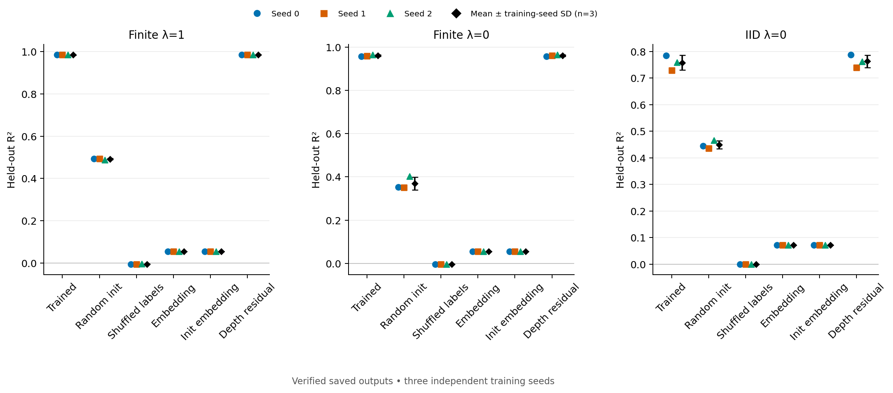

Running-count controls. Initialization controls independently choose their layer using fit-only CV; their cross-seed SD is initialization variation. All displayed scores preserve negative R² values.

[SVG](figures/count_validity_controls.svg) · [PDF](figures/count_validity_controls.pdf) · [Plot data](plot_data/count_validity_controls.json)

### Depth band controls

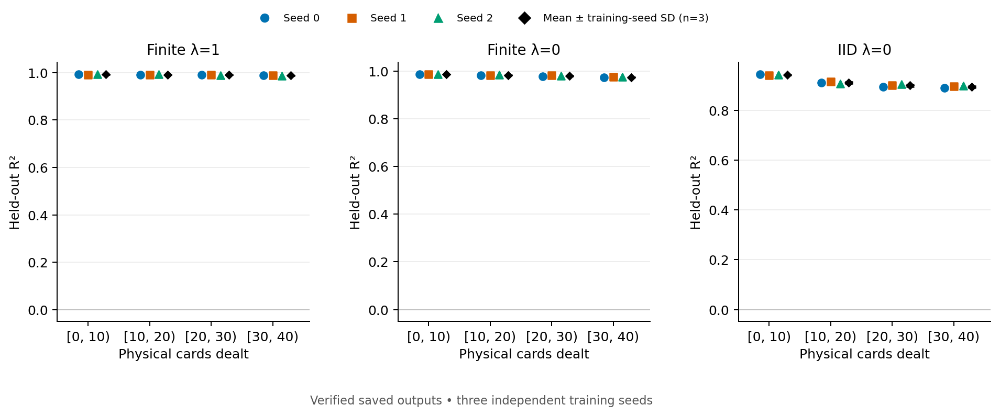

Running-count probe scores within declared physical-depth bands. Missing or undefined bands remain unplotted; no zero imputation.

[SVG](figures/depth_band_controls.svg) · [PDF](figures/depth_band_controls.pdf) · [Plot data](plot_data/depth_band_controls.json)

### Ev on action

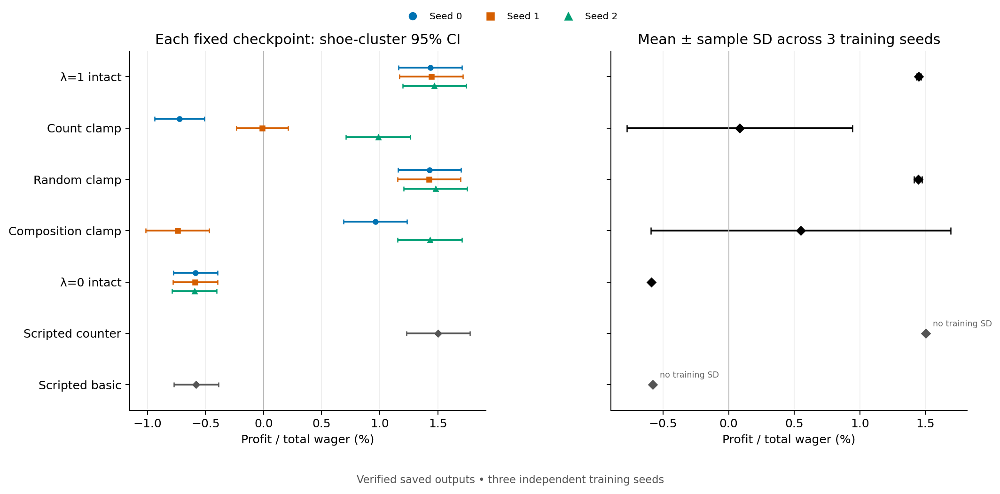

Left: asymptotic 95% intervals (±1.96 shoe-cluster SE), conditional on fixed checkpoint(s); matched shoe covariance retained for paired differences. Right: sample SD across 3 genuine training seeds, not CI. Scripted policies have no training SD. Fractions scaled by 100 only for plotting.

[SVG](figures/ev_on_action.svg) · [PDF](figures/ev_on_action.pdf) · [Plot data](plot_data/ev_on_action.json)

### Ev on initial

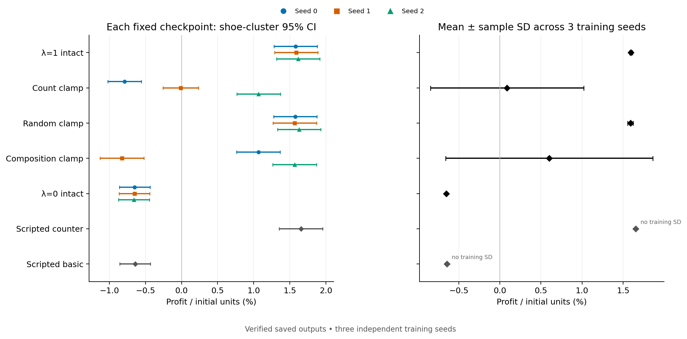

Left: asymptotic 95% intervals (±1.96 shoe-cluster SE), conditional on fixed checkpoint(s); matched shoe covariance retained for paired differences. Right: sample SD across 3 genuine training seeds, not CI. Scripted policies have no training SD. Fractions scaled by 100 only for plotting.

[SVG](figures/ev_on_initial.svg) · [PDF](figures/ev_on_initial.pdf) · [Plot data](plot_data/ev_on_initial.json)

### Paired ev differences

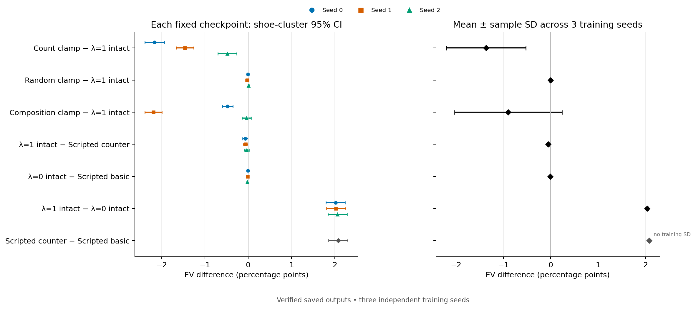

Left: asymptotic 95% intervals (±1.96 shoe-cluster SE), conditional on fixed checkpoint(s); matched shoe covariance retained for paired differences. Right: sample SD across 3 genuine training seeds, not CI. Scripted policies have no training SD. Fractions scaled by 100 only for plotting.

[SVG](figures/paired_ev_differences.svg) · [PDF](figures/paired_ev_differences.pdf) · [Plot data](plot_data/paired_ev_differences.json)

### Matched history

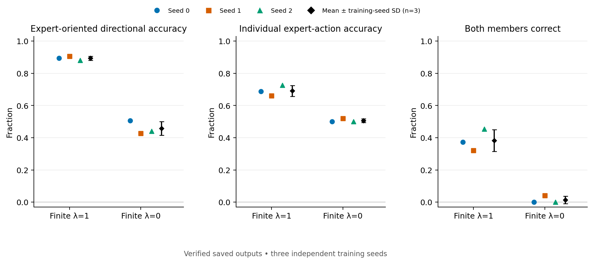

The same 75 engine-replayed matched pairs, five per 15 expert deviations, scored by six independently trained finite-deck models. Directional accuracy is the sign of the expert-oriented logit shift; individual accuracy uses 150 members and both-correct uses 75 pairs. Bars show sample SD across three training seeds.

[SVG](figures/matched_history.svg) · [PDF](figures/matched_history.pdf) · [Plot data](plot_data/matched_history.json)

### Bet patch strength curves

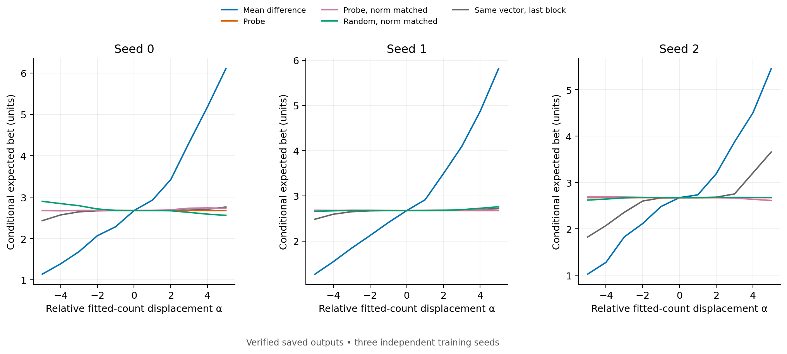

All 800 frozen held-out shoes per seed; calibration uses1200fit shoes. Bet patches are simultaneous at all ROUND_START positions; next-card patches affect only the current independent prefix. Relative α and empirical absolute running-count axes are not interchanged.

[SVG](figures/bet_patch_strength_curves.svg) · [PDF](figures/bet_patch_strength_curves.pdf) · [Plot data](plot_data/bet_patch_strength_curves.json)

### Nextcard patch strength curves

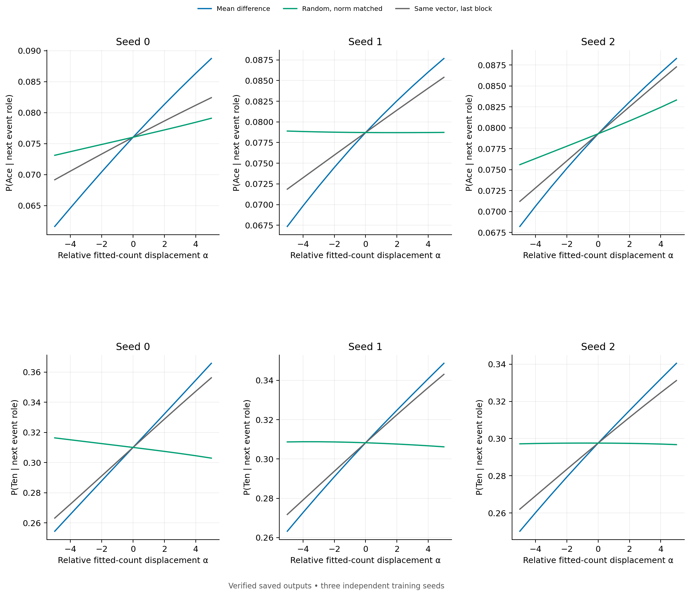

All 800 frozen held-out shoes per seed; calibration uses1200fit shoes. Bet patches are simultaneous at all ROUND_START positions; next-card patches affect only the current independent prefix. Relative α and empirical absolute running-count axes are not interchanged.

[SVG](figures/nextcard_patch_strength_curves.svg) · [PDF](figures/nextcard_patch_strength_curves.pdf) · [Plot data](plot_data/nextcard_patch_strength_curves.json)

### Sensitivity signed matrices

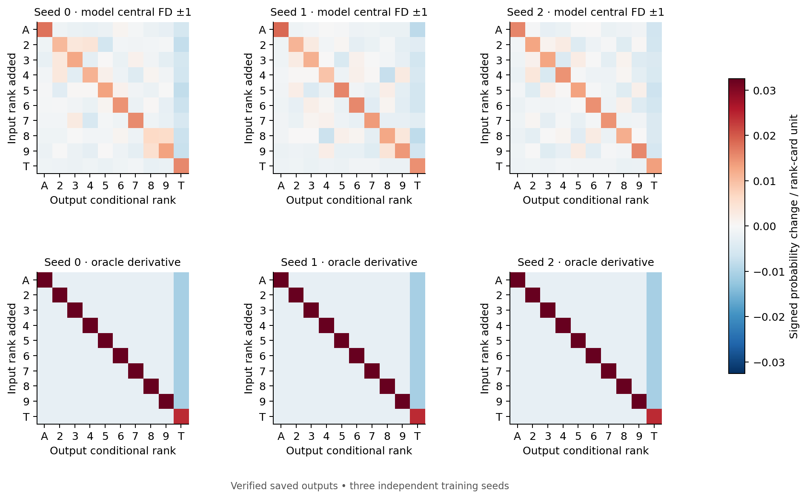

Unnormalized signed10×10 matrices share a symmetric color scale. Model central FD±1 and oracle derivative differ in finite-step convention; the full comparator table also retains the exact central oracle. Oracle composition includes hidden-hole depletion and is not the model's public-history Bayes distribution.

[SVG](figures/sensitivity_signed_matrices.svg) · [PDF](figures/sensitivity_signed_matrices.pdf) · [Plot data](plot_data/sensitivity_signed_matrices.json)

### Sensitivity direction and amplitude

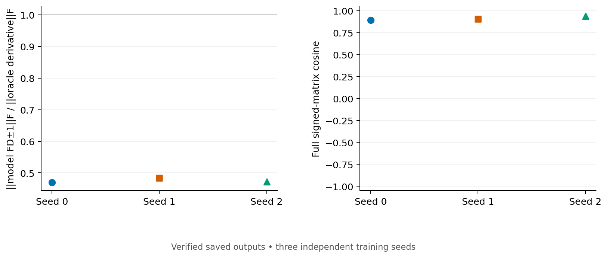

Amplitude is shown separately from directional alignment; no diagonal or Frobenius normalization is applied to the signed matrices. These display reductions are recomputed from collector-verified matrices.

[SVG](figures/sensitivity_direction_and_amplitude.svg) · [PDF](figures/sensitivity_direction_and_amplitude.pdf) · [Plot data](plot_data/sensitivity_direction_and_amplitude.json)

## Provenance and resource use

- [Completion evidence](evidence/final_headline_completion.json) · [Independent final verification](evidence/final_delivery_verification.json)
- [Collector report](evidence/collection_report.json) · [Figure manifest](evidence/figure_manifest.json) · [Approved scope](evidence/scope.json)
- [Compute usage, including failed jobs](evidence/compute_usage.csv)
- [Publication hashes](publication_manifest.json)

The broad collector retains its `INCOMPLETE` status for omitted dynamics and unsupported housekeeping adapters. The separate completion evidence verifies all 35 retained numerical comparison entries; it does not claim that the omitted analyses ran.

Recorded experiment use: 3.1128 GPU-hours of 11.5, 13.3789 allocated CPU-hours of 48, 77.89 GiB of 96, and $0 compute fees. No training or evaluation was rerun for this publication.
